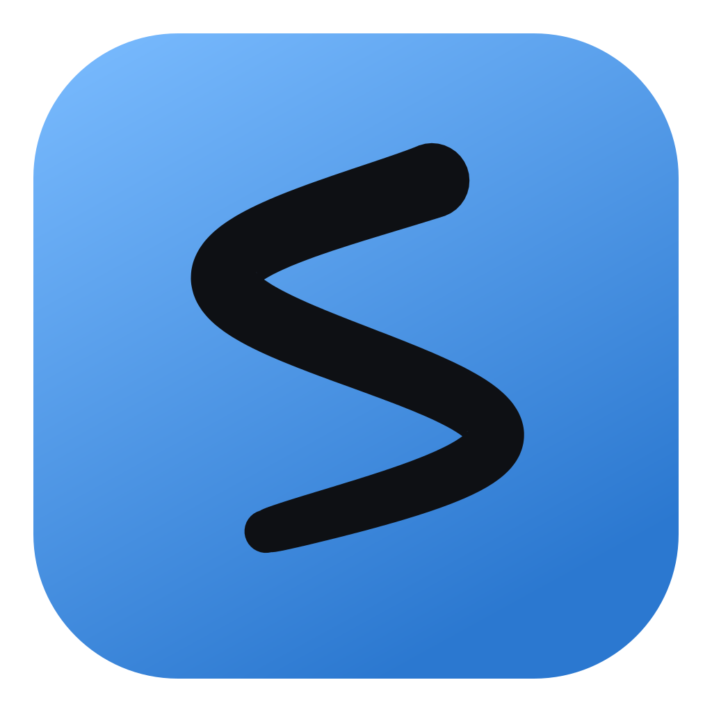

# Sussurro IA



**Dettatura vocale per Windows.** Tieni premuta una scorciatoia, parla, e il testo
compare nel campo in cui stavi già scrivendo — senza toccare il mouse, senza
cambiare finestra, senza copiare e incollare da nessuna parte.

La mail che stavi scrivendo, la casella di ricerca, il terminale, il commento in
un'altra applicazione: il testo va dove stava il cursore.

> ⚠️ **Versione beta.** Funziona, ma può contenere difetti e può cambiare senza
> preavviso. Non affidarti a Sussurro IA per lavoro critico o per testo che non
> puoi permetterti di perdere. Leggi le [condizioni d'uso](CONDIZIONI.md) prima
> di installare.

---

<!--
  DA FARE PRIMA DI DIVULGARE IL REPO: registrare una clip di 30 secondi.
  Apri il Blocco note, tieni premuto Ctrl+Win, di' una frase, rilascia, e mostra
  il testo che compare. Poi ripeti con Ctrl+Shift+Win per far vedere la
  traduzione. Salvala come GIF o MP4 e trascinala nell'editor di questo README:
  GitHub la carica e la incorpora da solo.

  È la cosa che convince: questa app è impossibile da descrivere e istantanea
  da mostrare.
-->

## Novità della 2.0

- **Trascrizione sul tuo computer**: se non vuoi che l'audio esca, scegli un
  modello dal cruscotto e lo trascrive Sussurro stesso. Vedi
  [Trascrivere sul proprio computer](#trascrivere-sul-proprio-computer).
- **Altre scorciatoie**: se il tasto `Win` ti dà fastidio, puoi usare
  `Ctrl`+`Alt` o `Ctrl`+`Shift`.
- **`Esc` annulla** la dettatura mentre registri, e le **mani libere** permettono
  di parlare senza tenere premuto niente.
- **Dizionario personale**: parole da riconoscere e sostituzioni fisse.
- **Taglio dei silenzi** prima della trascrizione, e **suoni di feedback**
  facoltativi.
- **Cruscotto rifatto**: un centro con lo stato del sistema e sette pagine
  numerate, da percorrere in ordine.
- **Copia l'ultima dettatura** dall'icona nell'area di notifica, se un'incolla è
  andata persa.

## Come si detta

| Scorciatoia | Cosa esce |
|---|---|
| `Ctrl` + `Win` | il testo così come l'hai detto, ripulito dagli intercalari e punteggiato |
| `Ctrl` + `Shift` + `Win` | il testo **tradotto** in inglese, spagnolo o tedesco |
| `Ctrl` + `Shift` + `Win` | oppure **riscritto come prompt**, se scegli quel modo |

Tieni premuto mentre parli, rilascia quando hai finito. Non c'è un tasto per
iniziare e uno per finire.

**Si detta in italiano.** È la lingua che l'app dichiara al servizio di
trascrizione, ed è quella su cui è tarata.

**Il modo prompt** merita una riga a sé: non traduce, resta in italiano. Prende
quello che hai raccontato a voce — «vorrei un'app che mi gestisce le fatture con
lo scadenzario» — e lo riscrive come richiesta ben posta, con i requisiti per
punti e l'elenco delle cose che non hai detto e che chi legge andrebbe altrimenti
a indovinare.

### Se il tasto Win ti dà fastidio

Dal cruscotto, pagina **03 scorciatoia**, puoi scegliere un'altra coppia:

| Scelta | Dettatura semplice | Dettatura tradotta |
|---|---|---|
| predefinita | `Ctrl` + `Win` | `Ctrl` + `Shift` + `Win` |
| Ctrl + Alt | `Ctrl` + `Alt` | `Ctrl` + `Alt` + `Shift` |
| Ctrl + Shift | `Ctrl` + `Shift` | `Ctrl` + `Shift` + `Alt` |

Con le scelte che usano `Alt` conta **solo l'Alt di sinistra**: `AltGr`, quello
con cui si scrivono `@ # [ ] €`, non fa mai partire una dettatura. Il cambio
vale subito, senza riavviare.

### Esc annulla, e le mani libere

Mentre registri, **`Esc`** butta via la dettatura: non viene trascritta né
inviata, e il tasto non arriva all'applicazione che hai sotto, così non ti chiude
anche il dialogo in cui stavi dettando. Fuori dalla registrazione `Esc` funziona
come sempre.

Le **mani libere** sono facoltative, spente di default (pagina **03
scorciatoia**). Con le mani libere accese, un **tocco breve** della combinazione
apre la registrazione e la lascia aperta: parli senza tenere niente premuto, e
per finire ripremi la combinazione. Dopo dieci minuti la registrazione si chiude
da sola, contro il microfono dimenticato aperto.

### Perfeziona il testo

C'è un interruttore — nel cruscotto, o con un clic sulla pillola — che cambia il
risultato di **entrambe** le scorciatoie: la dettatura non viene solo trascritta,
viene **riscritta in italiano scritto**. Si sciolgono i giri di parole, si ordina
la sintassi, spariscono intercalari e falsi inizi, e i concetti separati finiscono
in paragrafi distinti.

Quello che **non** fa, ed è la parte che conta:

- non aggiunge fatti, nomi, numeri o date che non hai detto;
- non riassume e non taglia: nessun contenuto sparisce;
- non attenua e non rafforza. «Questo contratto è una truffa» non diventa
  «ritengo che questo contratto sia una truffa»: aggiungere una prudenza che non
  avevi è un cambio di contenuto travestito da cambio di registro. Chi detta
  arrabbiato ha diritto a un testo arrabbiato, scritto bene.

### Comandi detti

Chi detta non può premere Invio né aprire il pannello delle emoji, quindi alcune
parole diventano quello che rappresentano, nel punto in cui le dici:

| Dici | Ottieni |
|---|---|
| «a capo», «vai a capo», «torna a capo», «nuova riga» | un a capo |
| «nuovo paragrafo», «doppio a capo» | una riga vuota di stacco |
| «emoji sorriso», «emoji pollice su», «emoji cuore», … | 🙂 👍 ❤️ |

Il prefisso «emoji» (o «faccina») è obbligatorio: «sorriso» e «cuore» da soli
sono parole correntissime, e riconoscerle significherebbe cancellarle dal testo
di chi le stava semplicemente dicendo.

I comandi non valgono nel modo prompt: lì «vai a capo» fa parte di ciò che stai
descrivendo.

### Dizionario personale

Nel cruscotto, pagina **05 dizionario**, ci sono due elenchi:

- **parole da riconoscere** — nomi, cognomi, sigle, termini tecnici che il
  trascrittore sbaglia. Arrivano al modello come suggerimento di ortografia:
  funziona meglio con poche voci davvero ostiche che con un elenco lungo;
- **sostituzioni** — correzioni fisse nella forma `da → a`, per esempio
  `chat gpt → ChatGPT`. Valgono per parole intere e servono per l'errore che si
  ripete sempre uguale.

### Silenzi e suoni

Prima di trascrivere, l'app **toglie i silenzi lunghi** dal clip e scarta quelli
senza voce («Non ti ho sentito»): ci sono meno secondi vuoti in cui il modello
potrebbe inventare frasi. È acceso di default e si spegne dalla pagina **01
trascrizione**, se hai una voce così debole da fartela tagliare.

I **suoni di feedback** (pagina **02 microfono**, spenti di default) dicono «ti
ascolto» e «ho finito» senza dover guardare la pillola.

## Installazione

Requisiti: **Windows 10 o 11 a 64 bit** e un microfono.

### Con winget — consigliato

```
winget install RobertoB.SussurroIA
```

Per questa via **non compare nessun avviso di SmartScreen** e non serve sbloccare
niente: winget scarica il file da sé, ne verifica lo SHA256 e non gli applica il
marchio da cui dipende l'avviso. Per aggiornare una versione già installata:

```
winget upgrade RobertoB.SussurroIA
```

Ogni nuova versione passa dall'approvazione del catalogo di winget, che di solito
richiede qualche giorno: finché la 2.0.0 non è approvata, winget installa la
versione precedente. Se vuoi la 2.0.0 subito, usa il download qui sotto.

### Dalla pagina Releases

Scarica dalla pagina **[Releases](../../releases/latest)**:

| File | Quando usarlo |
|---|---|
| `Sussurro.IA_2.0.0_x64-setup.exe` | installazione normale — **consigliato** |
| `Sussurro.IA_2.0.0_x64_it-IT.msi` | installazioni gestite, distribuzione aziendale |
| `sussurro.exe` | l'eseguibile da solo, se preferisci non installare niente |

Gli SHA256 sono pubblicati nel corpo di ogni release e in
[CHECKSUM.txt](CHECKSUM.txt): se vuoi verificare che il file scaricato sia quello
giusto, in PowerShell basta `Get-FileHash <file> -Algorithm SHA256`.

### Sblocca il file prima di eseguirlo

Sussurro IA **non è firmata** con un certificato di code signing: costa un token
hardware e un canone annuale, fuori portata per un programma gratuito. Senza
firma, Windows mostra **«Windows ha protetto il PC»** quando esegui un file
appena scaricato.

Il modo pulito di evitarlo richiede dieci secondi e va fatto **una volta sola**,
subito dopo il download:

1. Tasto destro sul file scaricato → **Proprietà**
2. In fondo alla scheda *Generale*, spunta **«Annulla blocco»**
3. **OK**, e poi esegui normalmente

Da PowerShell, se preferisci:

```powershell
Unblock-File "$HOME\Downloads\Sussurro.IA_2.0.0_x64-setup.exe"
```

Perché funziona: il browser marchia i file scaricati, e Windows mostra l'avviso
solo per i file che portano quel marchio. Toglierlo prima di eseguire è un gesto
consapevole — meglio che abituarsi a cliccare «Esegui comunque» su un avviso di
sicurezza, che è un riflesso da non allenare.

Se hai già eseguito il file e ti trovi davanti al pannello, la via d'uscita è
**Ulteriori informazioni → Esegui comunque**.

### L'antivirus potrebbe dire qualcosa

Sussurro IA aggancia la tastiera di sistema per riconoscere la scorciatoia, ed è
lo stesso meccanismo che usano i keylogger: un antivirus con analisi
comportamentale può segnalarlo. Che cosa il programma faccia davvero di quei
tasti — e perché il codice dei tasti normali non entra nemmeno nel programma — è
spiegato in [Che cosa esce da questo computer](#che-cosa-esce-da-questo-computer).

## Serve una chiave API Groq

Di preimpostazione Sussurro IA manda l'audio a **Groq**, che è di gran lunga il
più rapido sulle clip brevi — circa 350 ms per una frase. La chiave è tua,
l'account è tuo, e il piano gratuito **non chiede la carta di credito**.

Se preferisci che l'audio non esca dal computer, c'è il
[motore sul computer](#trascrivere-sul-proprio-computer). La chiave Groq resta
però necessaria per **tradurre**, per il **modo prompt** e per il
**perfezionamento del testo**: senza, quei modi inseriscono il testo trascritto
così com'è, e l'app te lo dice.

Due minuti in tutto:

1. **Registrati** su [console.groq.com](https://console.groq.com) — con Google,
   GitHub o una email. Niente dati di fatturazione, niente attese di approvazione.
2. **Apri** [console.groq.com/keys](https://console.groq.com/keys).
3. **Premi «Create API Key»** e dalle un nome qualsiasi, per esempio `sussurro-ia`.
4. **Copiala subito.** Compare una volta sola e comincia per `gsk_`. Se la perdi
   non è un dramma: si cancella e se ne crea un'altra, ma non c'è modo di
   rileggerla.
5. **Incollala nell'app**: clic sull'icona di Sussurro IA nell'area di notifica
   (vicino all'orologio) → **cruscotto** → pagina **01 trascrizione** → pannello
   **chiave API** → incolla e premi **salva**. La pastiglia diventa verde.

La chiave finisce nel **Gestore credenziali di Windows**, mai in un file, mai nei
log, e viene riletta dal portachiavi a ogni richiesta.

Il piano gratuito di Groq ha limiti di frequenza abbondanti per l'uso personale —
una dettatura è una richiesta di pochi secondi di audio. I limiti aggiornati sono
su [console.groq.com/settings/limits](https://console.groq.com/settings/limits).
Il costo delle trascrizioni, se un giorno superassi il piano gratuito, è a tuo
carico secondo le tariffe di Groq.

## Trascrivere sul proprio computer

Chi non vuole che l'audio esca dal computer può far trascrivere **a Sussurro
stesso**: il motore (whisper.cpp) è dentro l'app, non c'è niente da installare a
parte. Serve solo un **modello**, che si sceglie e si scarica dal cruscotto.

1. Cruscotto, pagina **01 trascrizione**: nel selettore **motore** scegli **sul
   computer — l'audio non esce**.
2. Compaiono tre modelli. Premi **scarica** su quello che vuoi: a download finito
   e verificato diventa il modello in uso.
3. Detta come sempre.

Non tutti i computer reggono il modello più grande, per questo sono tre. Le
misure sono di una frase di 10 secondi in italiano, su un processore a 8 core
senza scheda grafica:

| Modello | Peso | Tempo | Per chi |
|---|---|---|---|
| **Leggero** | 57 MB | ~1 s | PC poco potenti: risponde quasi subito, sbaglia più spesso nomi e parole rare |
| **Equilibrato** — consigliato | 181 MB | ~3 s | la maggior parte dei computer: buona precisione in italiano |
| **Preciso** | 547 MB | ~12 s | PC potenti: il più preciso, ma sul solo processore può metterci quanto hai parlato |

Da sapere:

- **Nessun modello si scarica da solo.** Il download parte solo quando premi
  **scarica**, dal repository pubblico di whisper.cpp su Hugging Face, e il file
  viene usato solo se peso e impronta SHA-256 coincidono con quelli attesi.
- **Offline funziona la dettatura semplice.** Traduzione, modo prompt e
  perfezionamento usano ancora Groq: gli mandano il **testo** già trascritto, non
  l'audio.
- **Nessun ripiego automatico sul cloud.** Se il modello scelto manca, la
  dettatura fallisce con un messaggio chiaro invece di mandare l'audio a Groq di
  nascosto.
- **Si torna al cloud** rimettendo il selettore su **cloud — Groq**. I modelli
  scaricati si tolgono dal disco con **elimina**, o tutti insieme con **libera
  spazio**.
- Il motore richiede un processore con istruzioni **AVX2** (Intel e AMD dal 2013
  circa). Sui processori più vecchi resta il cloud.

## Primo avvio

L'app parte in secondo piano: non ha una finestra principale. Quello che vedi è
una **pillola** sempre in primo piano, un ovale piccolo su un bordo dello schermo,
che mostra lo stato — a riposo, in ascolto, in elaborazione — e la sigla della
lingua di uscita.

La pillola **non mostra mai il testo**: quello va a destinazione, non sullo schermo.

Prima prova consigliata: apri il Blocco note, tieni premuto `Ctrl`+`Win`, di'
qualcosa, rilascia.

Dall'icona nell'area di notifica si apre il **cruscotto**, si **copia l'ultima
dettatura**, si sospende la dettatura o si esce.

### Il cruscotto

Si apre sul **centro**: un cerchio con lo stato del sistema, da cui partono sette
linee verso sette pagine numerate. L'ordine è quello in cui ha senso percorrerle:
prima si configura, poi si detta, e la diagnostica serve quando qualcosa non va.

| Pagina | A cosa serve |
|---|---|
| **01 trascrizione** | motore cloud o sul computer, i modelli da scaricare, taglio dei silenzi, chiave API |
| **02 microfono** | microfono, posizione della pillola, avvio con Windows, suoni di feedback |
| **03 scorciatoia** | quale coppia di tasti usare, mani libere, sospensione |
| **04 testo** | che cosa fa la combinazione tradotta, perfezionamento, scelta e prova dei modelli |
| **05 dizionario** | parole da riconoscere e sostituzioni |
| **06 detta** | il promemoria di come si detta e le ultime dettature con il loro esito |
| **07 diagnostica** | la catena del segnale, il registro tecnico, le azioni di riparazione |

### Scegliere i modelli

Nella pagina **04 testo** si può cambiare il modello usato da ciascuno dei due
slot — quello che trascrive la voce nel cloud e quello che traduce o riscrive.
Puoi chiedere all'endpoint l'elenco dei modelli adatti a quel mestiere, oppure
scrivere un nome a mano se il filtro è troppo severo.

Prima di adottarne uno puoi **provarlo**: l'app gli manda le frasi che smascherano
i modelli che *rispondono* invece di tradurre — «qual è la capitale della
Francia?» deve tornare tradotta, non deve tornare «Parigi» — e lo fa **in tutte le
lingue di uscita**, non solo in quella attiva. Il motivo è concreto: le difese
contro quel comportamento non reggono allo stesso modo in ogni lingua, e provarne
una sola significa scoprire il problema il giorno in cui cambi lingua, a metà di
una dettatura, con il testo già finito nel documento.

## Che cosa esce da questo computer

La stessa informativa compare al primo avvio dell'app e si rilegge quando vuoi dal
collegamento **«che cosa esce da questo computer»**, sotto il cerchio del
cruscotto.

**L'audio** esce solo mentre registri — tenendo premuta la combinazione, o fra i
due tocchi se hai attivato le mani libere — e va al servizio che hai configurato
tu con la tua chiave. Fuori da quei secondi il microfono non registra. Con il
**motore sul computer** l'audio non esce affatto: lo trascrive Sussurro stesso.
Traduzione, modo prompt e perfezionamento mandano a Groq il **testo** già
trascritto, non l'audio.

**La tastiera.** Per riconoscere una combinazione di soli modificatori Windows non
offre alternative a un hook di sistema, che per costruzione riceve ogni tasto
premuto sul computer. Sussurro IA **scarta il codice dei tasti che non sono
modificatori nel punto esatto in cui lo riceve**, prima di qualunque altra
operazione: non entra nel programma, non viene salvato, non viene trasmesso. Di
ciò che digiti resta soltanto il fatto che un tasto è stato premuto, che serve ad
annullare la dettatura quando stai usando un'altra scorciatoia. L'unica
eccezione è un'informazione sola: mentre registri, il programma riconosce `Esc`,
perché annulla la dettatura. Fuori dalla registrazione nemmeno `Esc` viene
identificato.

**Gli appunti** vengono letti per conservarne il contenuto, usati per incollare il
testo, e **ripristinati subito dopo**. Se però l'inserimento non riesce — la
finestra di destinazione non c'è più, o rifiuta l'incolla — il testo dettato
resta negli appunti perché tu possa incollarlo con Ctrl+V invece di perderlo, e
in quel caso il contenuto precedente non viene ripristinato.

**Il testo dettato** non viene mai scritto su disco e non compare nei log.
L'ultima dettatura resta solo in memoria, per il comando «Copia l'ultima
dettatura», e sparisce chiudendo l'app.

**Il registro tecnico** (pagina 07) tiene le ultime 500 righe di diagnosi, solo in
memoria. Contiene nomi di programmi e titoli di finestre, mai il testo dettato, e
non lo manda nessuno: lo copi tu con **copia diagnostica**. Rileggilo prima di
allegarlo a una segnalazione, perché un titolo di finestra può essere il nome di
un documento.

**Sul computer restano** le preferenze in un file di testo (`impostazioni.json`,
nessun segreto: fra le altre cose il dizionario che hai scritto, in chiaro), la
chiave API nel Gestore credenziali e, se li hai scaricati, i modelli locali in
`%LOCALAPPDATA%\com.sussurroia.app\modelli`.

**Verso chi ha realizzato il programma non arriva niente.** Nessuna telemetria,
nessuna statistica d'uso, nessun controllo aggiornamenti. Le connessioni di rete
che l'app apre sono soltanto quella verso il servizio che hai configurato e il
download di un modello locale, quando lo chiedi tu.

## Se qualcosa non va

| Sintomo | Dove guardare |
|---|---|
| le scorciatoie non rispondono più | cruscotto → **07 diagnostica** → azioni → **forza reinstallazione hook** |
| registra ma non esce testo | pagina **01 trascrizione**: la pastiglia della chiave API è verde? Con il motore sul computer, c'è un modello **in uso**? |
| il testo non si incolla | se la pillola dice «Inserito senza conferma», la dettatura è negli appunti: premi `Ctrl+V`, o riprendila da **Copia l'ultima dettatura** nell'area di notifica |
| «Scegli un modello locale» o «non è scaricato» | pagina **01 trascrizione**: scarica un modello, oppure torna al cloud |
| il testo finisce nella finestra sbagliata | pagina **07**: verifica che **pillola non attivabile** sia spuntato |
| esce testo su frasi mai dette | è un'allucinazione sul silenzio: parla più vicino al microfono |
| il menu Start si apre a ogni dettatura | spunta **blocca il menu Start al rilascio di Win**, o scegli una scorciatoia senza `Win` nella pagina **03** |
| non capisci dove si è fermata | la **catena del segnale**: il contatore che smette di crescere dice quale giunzione è muta |

Se non basta, **[apri una segnalazione](../../issues/new/choose)**. Nel modulo
trovi già le domande che servono a capire il problema senza scambi di messaggi.

> Non incollare mai nelle segnalazioni la tua **chiave API** né il **testo che hai
> dettato**: le issue sono pubbliche.

Per domande, idee e richieste di funzionalità c'è la sezione
**[Discussions](../../discussions)**.

## Licenza

Software proprietario, gratuito da usare. **Tutti i diritti riservati.**
Le condizioni complete sono in [CONDIZIONI.md](CONDIZIONI.md) e vengono mostrate
durante l'installazione.

Il codice sorgente non è pubblico. Questo repository serve alla distribuzione,
alle segnalazioni e alla documentazione. Il motore di trascrizione sul computer
usa [whisper.cpp](https://github.com/ggml-org/whisper.cpp) (licenza MIT) e i
modelli Whisper pubblicati da quel progetto.
